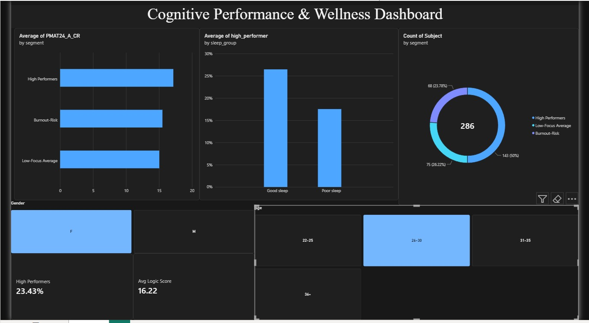

# Cognitive Performance & Wellness Analytics

[](https://www.python.org/)
[](https://cognitive-carnival.streamlit.app/)
[](https://opensource.org/licenses/MIT)

**Python | SQL (DuckDB) | Power BI | Streamlit | scikit-learn | Segmentation Analysis | KPI Dashboard**

**Live app:** [cognitive-carnival.streamlit.app](https://cognitive-carnival.streamlit.app/)



## Business Problem

Organisations want to know which people are at risk of underperforming and which factors are worth investing in. This project uses data on 1,195 adults to answer three questions:

1. Which performance profiles exist, and how big is each one?
2. Which factors (sleep, memory, focus, emotion recognition, life satisfaction) matter most for performance?
3. Where should a wellness or training programme put its effort first?

The data comes from healthy adults, not employees, so it is used here as a stand-in for a workforce.

**Who would use this:** HR and people analytics teams, wellness programme managers and team leads.

## KPIs Tracked

| KPI | Value |
|---|---|
| People analysed | 1,195 |
| Average logic score | 16.7 |
| High performers (logic score at or above the 80th percentile) | 26.9% |
| Average sleep problem score (lower is better) | 4.9 |

## Key Insights

- **Sleep:** only 21% of poor sleepers are high performers, against 30% of good sleepers.
- **Memory:** the high-performer rate rises from 16% in the lowest memory quarter to 39% in the highest.
- **Combined effect:** good sleep with strong memory gives 36% high performers. Poor sleep with weaker memory gives 15%.
- **Segments:** clustering found three groups: High Performers (49%), Low-Focus Average (32%) and Burnout-Risk (20%). The Burnout-Risk group stands out for its sleep problems.
- **Strongest driver:** working memory has the largest effect on logic scores, followed by emotion recognition. Sleep problems pull scores down.

## Recommendations

1. **Make sleep support a priority,** starting with the Burnout-Risk segment (flexible hours, workload review, wellness programme).
2. **Invest in memory and focus training,** especially for the Low-Focus Average segment.
3. **Target support by segment** instead of running one programme for everyone.

## Approach

1. **Data preparation:** cleaned the dataset in pandas and flagged high performers and sleep groups.
2. **SQL analysis:** five business questions answered in [queries.sql](queries.sql) using DuckDB. Run them with `python run_sql.py`.
3. **Segmentation:** K-Means (3 clusters) on memory, focus, emotion recognition and sleep, scaled first.
4. **Driver analysis:** multiple linear regression on standardized features, so effects are comparable.
5. **High-performer model:** balanced logistic regression, evaluated with 5-fold cross-validation.
6. **Dashboards:** an interactive Streamlit app and a Power BI report ([Cognitive_Dashboard.pbix](Cognitive_Dashboard.pbix)) with KPI cards, segment charts and age and gender filters.

## Model Results

| Model | Result |
|---|---|
| Linear regression (average logic score) | R-squared about 13% |
| Logistic regression (high performers) | AUC 0.65, recall 62%, precision 35% |

These factors explain only part of logic scores, so the results are best used to spot patterns, not to judge individuals.

## Project Structure

```
app.py                    Streamlit dashboard
queries.sql               Business questions in SQL
run_sql.py                Runs the SQL queries with DuckDB
Cognitive_Dashboard.pbix  Power BI report
dataset.csv               Source data
dataset_for_powerbi.csv   Data with segment and flag columns for Power BI
requirements.txt          Python packages
```

## Run Locally

```
git clone https://github.com/asitapathak/cognitive-carnival.git
cd cognitive-carnival
pip install -r requirements.txt
streamlit run app.py
```

To run the SQL queries, also run `pip install duckdb` and then `python run_sql.py`.

## Limitations

- The results show correlation, not cause and effect.
- The sample is healthy adults from the Human Connectome Project, not employees.
- Logic score is one measure of performance, not the whole picture.
- The 36+ age group is very small (14 people), so read it with care.

## Data Source

Human Connectome Project (HCP) 1200 Subjects Release, funded by the NIH. Metrics come from standardized NIH Toolbox and sleep (PSQI) assessments.

## License

MIT
